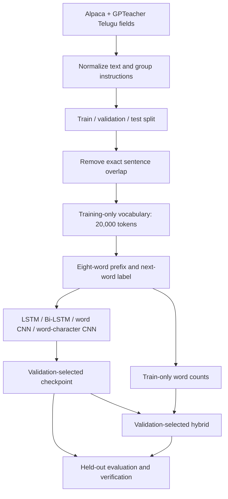
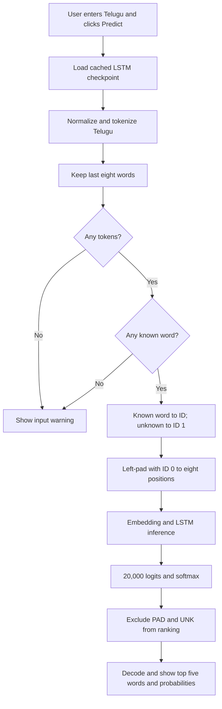

# Full project architecture

## Training pipeline



## Neural model internals

| Model | Architecture |
|---|---|
| LSTM | 64-dimensional embedding; one 128-unit LSTM; final hidden state; 20,000-class linear head |
| Bi-LSTM | 64-dimensional embedding; 128 units in each direction; concatenate terminal states to 256 features; linear head |
| Word CNN | Embedding 64; 1x1 projection to 128 channels; three gated residual causal convolutions, kernel 3, dilation 1/2/4; final-position head |
| Word-character CNN | Word embedding 64 plus character embedding 16; kernel-3 character CNN; masked max pooling to 64 features; learned fusion; projection and same causal CNN |

Bi-LSTM processes only the observed prefix in both directions. It never sees the target. Character inputs retain the last 32 Unicode code points. Character features are learned spelling features, not explicit morphological analysis. Output remains a fixed vocabulary.

### Formulas

```text
f_t = sigmoid(W_f x_t + U_f h_(t-1) + b_f)
i_t = sigmoid(W_i x_t + U_i h_(t-1) + b_i)
g_t = tanh(W_g x_t + U_g h_(t-1) + b_g)
c_t = f_t * c_(t-1) + i_t * g_t
o_t = sigmoid(W_o x_t + U_o h_(t-1) + b_o)
h_t = o_t * tanh(c_t)
Bi-LSTM representation = concat(h_forward, h_backward)
CNN residual = (h + value * sigmoid(gate)) / sqrt(2)
Fusion gate g = sigmoid(W[e;c] + b)
Word-character representation = g*e + (1-g)*c
p(next word) = softmax(W_out h + b_out)
Loss = -log p(recorded next word)
```

## Hybrid models

V1 learns unigram and one-/two-word-context counts. Contexts need at least three occurrences; otherwise it backs off. Validation selected 75% Bi-LSTM and 25% count probabilities.

V2 adds three-/four-word contexts. It smooths longer-context distributions toward shorter contexts with confidence n/(n+5), where n is the training count. Validation selected a 50/50 count/Bi-LSTM mixture. It has higher test top-1 but lower top-5 than V1. Both models and their selection records are retained.

## Application input-to-output flow



The app retains the original LSTM default and hidden controls. The hybrid experiments are saved separately and are not silently substituted into the UI. Inference uses saved weights without retraining. Original probabilities are displayed without renormalizing after filtering. Checkpoint-loading failures show an error.

## Evaluation

All current experiments share 3,483,073 training, 198,928 validation and 200,092 test examples. Unknown targets count as misses. Vocabulary and count fitting use training only. Selection uses validation top-1 for improvement experiments; original neural baselines used validation loss. Test results are for reporting, not selection. Repeated test reporting and single-seed training limit claims; fresh independent evaluation and ablations remain future work.
